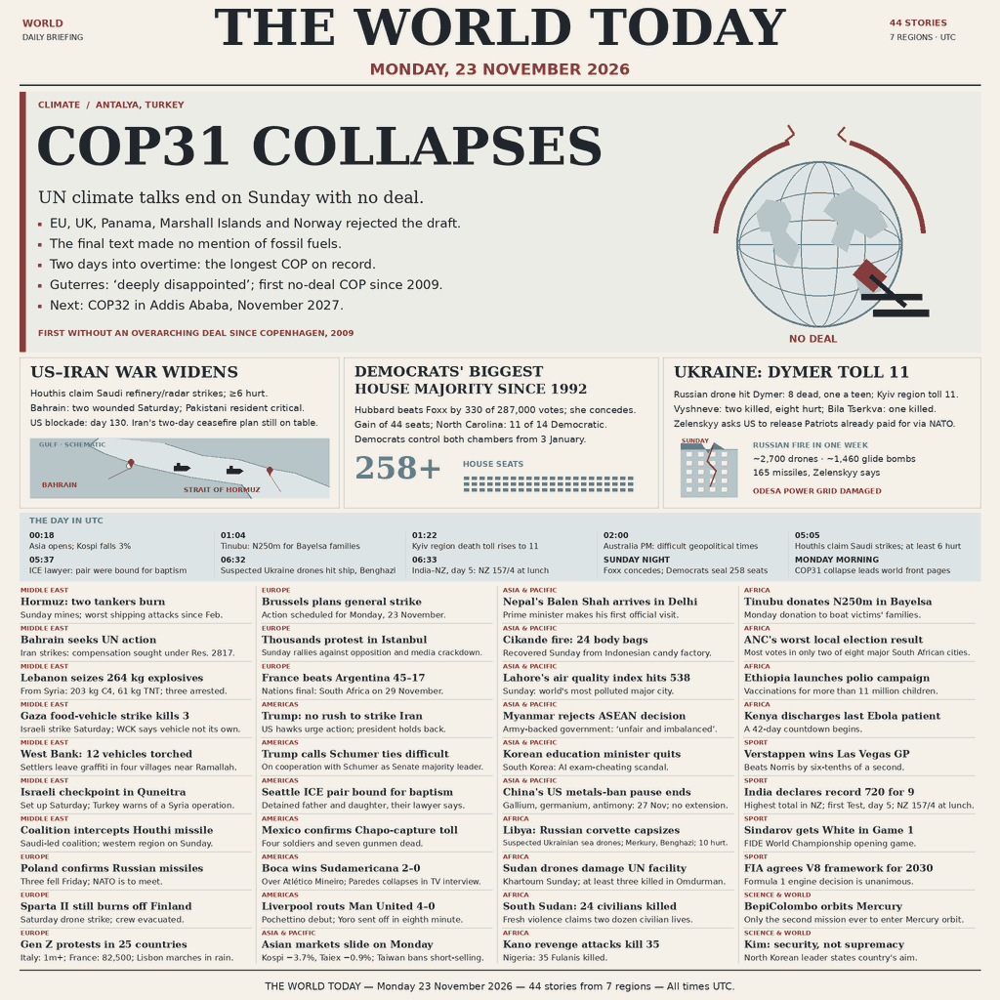

# THE WORLD TODAY — 23 November 2026

A newspaper front page for Monday, 23 November 2026: the collapse of COP31 leads 44 stories across seven regions, with three illustrated news panels, a pinned schematic Gulf map, and a ten-item UTC timeline. Fixed text and flat Pillow shapes are drawn at 2048 × 2048 and downsampled to a compact 1024 × 1024 RGB PNG. Render offline with `python3 render.py` using installed Pillow and the system DejaVu fonts; use `python3 render.py --output second.png` for a repeat render. Run the dependency-free copy program with Node 24 or later: `MAKEFUN_OUTPUT_DIR=./output node main.ts`. It copies the bundled image and prints its destination; the default output directory is `/output`.

